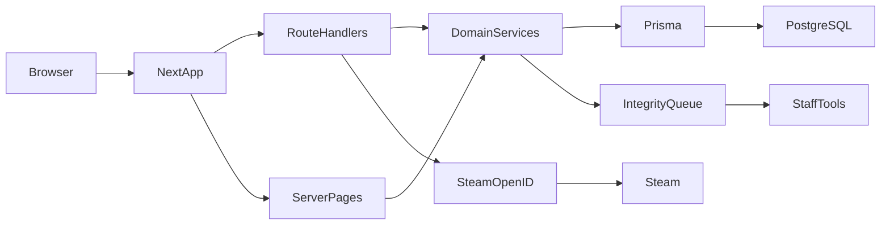

# A.C.E. architecture

This document explains how the main parts of A.C.E. will fit together. Most of these parts are **planned**. Today the repo is a Next.js App Router starter under `src/app/` with no database and no authentication.

## Current shape

- **App:** `ace-platform` (Next.js 16 App Router, React 19, TypeScript, Tailwind CSS v4).
- **UI entry:** `src/app/page.tsx`, `src/app/layout.tsx`, `src/app/globals.css`.
- **Scripts:** `npm run dev`, `npm run lint`, `npm run build`, `npm start`.
- **Not present yet:** PostgreSQL, Prisma, Steam login, tests, `.env.example`.

Read `AGENTS.md` and `node_modules/next/dist/docs/` before changing Next.js APIs. This project’s Next.js version may differ from older tutorials.

## Target shape (incremental)

Keep **one Next.js application** for the web product. Do not add a separate backend service until a later decision is recorded in `DECISIONS.md`.

Plain language:

- The **browser** talks only to the Next.js app.
- **Server pages** render HTML (profiles, rankings, tournaments).
- **Route handlers** handle sign-in callbacks, form posts, and JSON APIs.
- **Domain services** (planned under `src/server`) contain rules: who can join a team, who can ban a player, how a report is stored.
- **Prisma** talks to **PostgreSQL** when the database stage begins.
- **Steam OpenID** is used only on the server. Players never type a Steam password into A.C.E.
- **Integrity queue** is a staff review list first. It is not an AI anti-cheat.

The **desktop app** is a later client. It is not in this diagram until the web app is stable.

## Planned folders

Create folders only when a stage needs them. Do not scaffold empty trees in advance.

| Path | Role |
| --- | --- |
| `src/app/` | Routes, layouts, route handlers |
| `src/components/` | Reusable UI (header, buttons, cards) |
| `src/lib/` | Shared helpers that are safe in more than one place |
| `src/server/` | Database access, auth session helpers, permission checks |

Sensitive checks (who is signed in, who is staff) belong in `src/server` or route handlers, **never only in the browser**.

## Rendering and data

- Prefer server components for pages that read data.
- Use client components only for interactivity (menus, forms that need browser state).
- When authentication exists, do not cache personalized pages as if they were public. Next.js 16 currently enables `cacheComponents` and `partialPrefetching` in `next.config.ts`. User-specific data must be treated as uncached or correctly tagged when that stage starts.

## Database (later)

- **PostgreSQL** is the planned relational database.
- **Prisma** is the planned ORM. Add a **stable, production-ready** Prisma version only when Stage 3 starts. Pin the version then; do not add prerelease packages without recording why in `DECISIONS.md`.
- First schema sketch (not implemented now): users, Steam accounts, sessions, teams, team memberships, tournaments, matches, integrity reports, staff roles.

## Authentication (later)

- Planned: **Auth.js (NextAuth)** with **Steam OpenID**, self-hosted sessions.
- Do not use a paid auth SaaS unless the project owner authorizes the cost.
- Confirm the Steam provider still works before implementing Stage 4.
- Sessions are server-side. The browser must not be the source of truth for “this user is staff.”

## Match integrity (later)

- **Near term:** players submit reports; staff review them in a queue.
- **Later:** desktop/client tooling. Do not claim autonomous AI anti-cheat exists.
- Report storage and staff actions go through the server.

## Styling

- Tailwind CSS v4 is already in the project (`@import "tailwindcss"` in `globals.css`).
- First implementation stage should define theme tokens for:
  - charcoal `#121212`
  - graphite gray
  - white
  - gold `#D4AF37` / `#FFD700`
- Do not add a second CSS framework or a large UI kit unless `DECISIONS.md` records a reason.

## Desktop application (much later)

- Electron (or another desktop shell) is forbidden until the web application is stable: branded UI, real auth, core profiles/teams/tournaments, and server-side permissions.
- The desktop app must not become a second copy of business rules. Shared rules stay on the server where possible.

## What not to add yet

- Prisma, PostgreSQL connection strings, Auth.js, Steam API usage, Electron, payment SDKs, extra UI libraries.
- A second backend framework.
- Environment files until a stage actually needs secrets. When that happens, add `.env.example` with placeholders only, and allow it in `.gitignore` (`!.env.example`).
